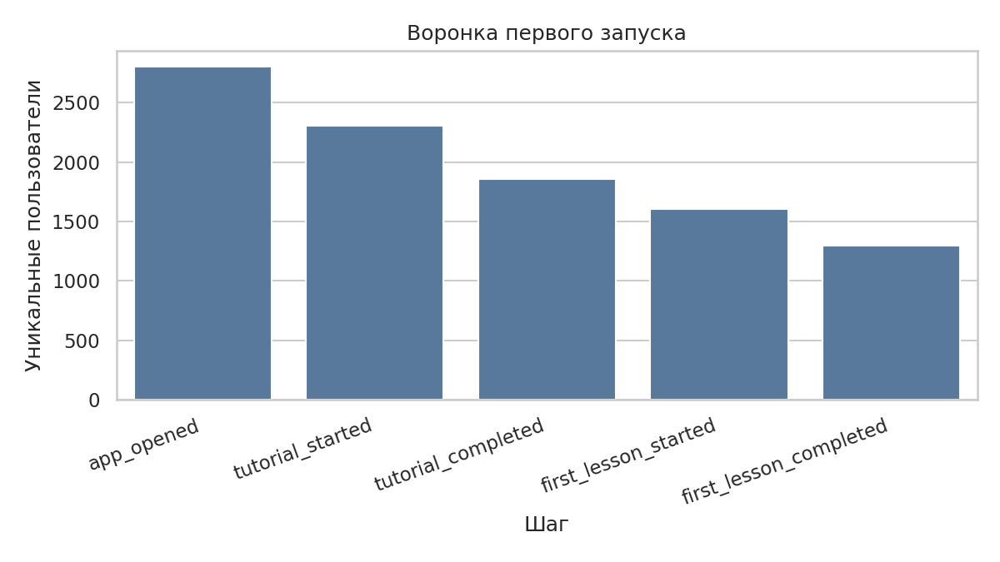
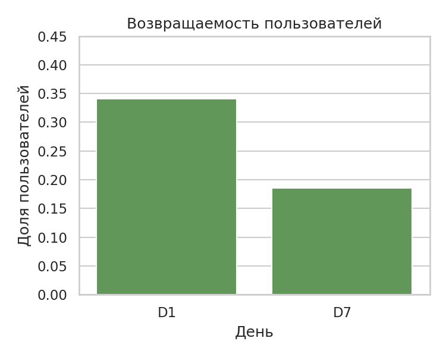

# Активация и удержание пользователей мобильного приложения

Разбор первых шагов пользователя в приложении: от открытия до завершения первого урока. Дополнительно считаются активация в первые 24 часа и возвращаемость на D1/D7.

**Данные синтетические.** Они созданы для демонстрации расчётов и не относятся к реальному приложению.

## Что анализируется

- качество таблиц пользователей и событий;
- onboarding-воронка по уникальным пользователям;
- Activation Rate — завершение первого урока в течение 24 часов после регистрации;
- Retention D1 и D7 — наличие `session_started` на календарный день +1 и +7;
- активация в разрезе каналов привлечения и платформ.

## Результаты

| Метрика | Значение |
|---|---:|
| Пользователи | 2 800 |
| События | 14 804 |
| Activation Rate за 24 часа | 46,4% |
| Retention D1 | 34,1% |
| Retention D7 | 18,5% |

Самая большая абсолютная потеря в onboarding-воронке происходит между открытием приложения и началом обучения: 492 пользователя. Среди каналов в этой выборке выше активация у Referral (60,0%), ниже — у Paid Ads (35,5%). На iOS показатель составляет 53,5%, на Android — 41,9%.

Эти различия подсказывают, что стоит изучить первые экраны и качество привлечённого трафика. Они не доказывают причину поведения пользователей.

## Материалы

- `notebooks/01_activation_retention_analysis.ipynb` — расчёты и графики.
- `sql/01_product_metrics.sql` — SQL-запросы для повторения основных метрик.
- `data/users.csv`, `data/events.csv` — исходные таблицы.
- `reports/figures/` — графики; `reports/tables/` — таблицы с результатами.





## Запуск

Из папки проекта установите зависимости и откройте ноутбук в Jupyter:

```bash
pip install -r requirements.txt
jupyter notebook
```

Откройте `notebooks/01_activation_retention_analysis.ipynb` и выполните ячейки сверху вниз.

Для SQL-части импортируйте `users.csv` и `events.csv` в PostgreSQL как таблицы `users` и `events`, затем выполните запросы из `sql/01_product_metrics.sql`.

## Определения и ограничения

Активация засчитывается только при завершении первого урока в течение 24 часов после регистрации. D1/D7 считаются по календарным датам, а не по скользящим окнам в 24/168 часов. Воронка использует наличие событий и не проверяет временные интервалы между ними. Поскольку данные синтетические, результаты нельзя использовать как реальные продуктовые бенчмарки.
